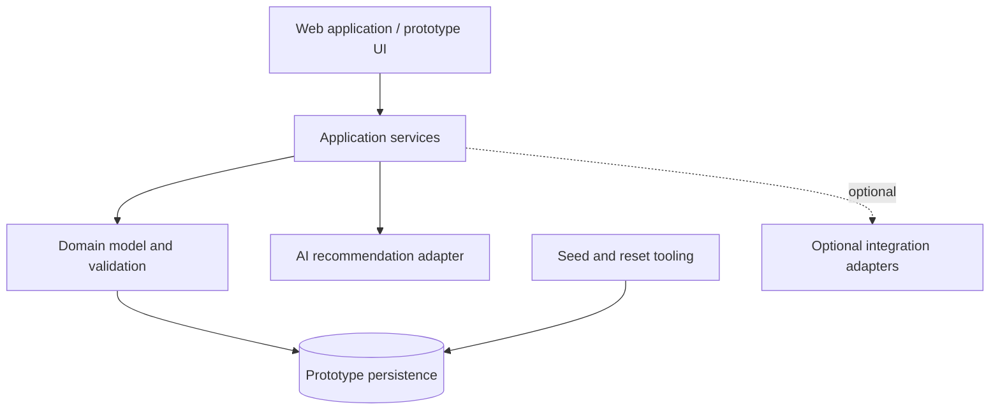

# MATILDA Prototype Architecture

## Purpose

This document defines the technical boundaries and architecture principles for the MATILDA prototype. It intentionally does not lock a technology stack before the team chooses one.

## Architecture objective

Build the simplest credible architecture that can demonstrate:

```text
capture
→ structured intelligence
→ Account Plan impact
→ Action
→ Account Review
→ Opportunity development
→ learning
```

The architecture should be easy to understand, seed, test, and change during rapid prototyping.

## Non-goals

The prototype is not optimised for:

- enterprise scale;
- multi-tenancy;
- complex roles and permissions;
- production Microsoft 365 integration;
- production security certification;
- a general workflow engine;
- high-volume event processing;
- advanced analytics infrastructure;
- billing or forecasting;
- exhaustive administration; or
- long-term platform abstraction.

## Architectural principles

1. **Domain first** — code and storage should use MATILDA's domain language.
2. **Simple persistence** — choose a storage model that supports relationships and reliable seed/reset.
3. **Explicit provenance** — retain Source, actor, timestamps, and AI origin where relevant.
4. **No silent mutation** — AI proposals remain separate or visibly pending until human acceptance.
5. **Deterministic demo path** — core scenarios should work reliably even if some AI is mocked.
6. **Replaceable boundaries** — isolate prototype AI and integration adapters so they can evolve later.
7. **Readable over abstract** — prefer straightforward modules to premature frameworks.
8. **Structured source of truth** — generated views and summaries derive from domain data.
9. **Change visibility** — material updates should be explainable over time.
10. **Honest capability** — never claim an AI action the implementation did not perform.

## Logical architecture



### Presentation layer

Responsibilities:

- Account navigation and screens;
- fast Observation capture;
- visual distinction among information types;
- provenance and freshness inspection;
- proposed-change review;
- decision-oriented Account Review;
- Opportunity qualification; and
- contextual MATILDA Assistant.

The presentation layer must not manufacture domain state or treat generated summaries as the system of record.

### Application layer

Responsibilities:

- workflow orchestration;
- commands and queries;
- generation of Account Plan and Review views;
- recommendation acceptance, editing, and rejection;
- change logging;
- Action and Decision consequences;
- demo reset; and
- consistent transaction boundaries.

Examples of application services:

- `CaptureObservation`
- `ValidateInsight`
- `ResolveKnowledgeGap`
- `ProposeAccountPlanChange`
- `PrepareAccountReview`
- `RecordReviewDecision`
- `AssessOpportunityQualification`
- `CompleteActionWithOutcome`

These are examples, not required class names.

### Domain layer

Contains the entities and rules in `data-model.md`.

Responsibilities:

- Account ownership;
- information-type and validation rules;
- state transitions;
- cross-entity link validation;
- Opportunity qualification semantics;
- distinction among recommendation, Decision, Action, and outcome; and
- freshness calculations.

### Persistence layer

The first implementation may use a local relational database, hosted relational database, lightweight document store, or Microsoft Lists/SharePoint if that choice accelerates the prototype.

Selection criteria:

- easy local or preview deployment;
- explicit relationships;
- predictable querying;
- rapid seed/reset;
- simple migration story;
- reasonable inspection during demos; and
- low operational overhead.

A relational model is a natural fit, but no database product is mandated here.

## Data ownership

Structured domain data is authoritative.

- The Account Plan is a view over Account, Insights, Goals, Initiatives, Relationships, Actions, Opportunities, Knowledge Gaps, and risks.
- Account Review summaries are generated from current data and material changes, then finalised with human Decisions.
- Opportunity qualification derives from evidence and explicit gaps.
- Assistant responses are transient unless a human chooses to create or change a domain record.

Do not store a second independent copy of the Account Plan or Review content merely to render a screen.

## AI architecture

Use an adapter boundary between application workflows and AI capability.

The adapter may initially return:

- deterministic fixtures for the canonical demo;
- rule-based suggestions;
- recorded model output; or
- live model output when available.

All modes must return the same conceptual recommendation envelope:

```text
recommendation
reasoning
supporting evidence references
uncertainty
missing information
proposed domain change or Action
model/mode metadata when useful
```

### AI proposal lifecycle

```text
Generated
→ Pending human review
→ Accepted | Edited and accepted | Rejected
```

Only accepted material proposals become validated domain state. Retain enough metadata to show that the proposal originated from MATILDA.

### Grounding rules

- Link recommendations to existing Insight and Source IDs when available.
- Distinguish retrieval from inference.
- Do not create synthetic citations to absent Sources.
- If evidence is insufficient, say so and create or propose a Knowledge Gap.
- Do not present probabilistic model output as a Fact.

## Write paths

### Capture Observation

1. User submits minimal text and Account context.
2. Application stores or stages the user's original Observation.
3. AI proposes classification, links, gaps, and Actions.
4. UI displays proposals and evidence.
5. User accepts, edits, or rejects.
6. Application commits approved changes and logs the actor and origin.

### Record Review Decision

1. Application prepares Review content from live data and changes.
2. Participants inspect and edit the generated summary.
3. An authorised human records a Decision.
4. The Decision creates or updates Actions explicitly.
5. Resulting changes are logged.

### Complete Action with outcome

1. User completes the Action and records an outcome.
2. MATILDA proposes new or changed Insights, Knowledge Gaps, and Opportunity impact.
3. Human validates material updates.
4. Accepted learning becomes reusable Account Intelligence.

## Read models

Optimised read models or view-model projections may be used for:

- Account Overview;
- Knowledge Map;
- Account Plan;
- Review change summary;
- Opportunity qualification matrix; and
- contextual Assistant answers.

They must be reproducible from domain data and must not become competing systems of record.

## Change history and audit

A production-grade event architecture is not required. For material changes, retain:

- entity type and ID;
- changed field or relation;
- previous and new value when practical;
- timestamp;
- human or AI actor;
- reason or Source reference where relevant; and
- originating workflow.

This supports “what changed?” and makes AI influence inspectable.

## Freshness

Freshness can be calculated from:

- `observed_at`;
- `validated_at`;
- `last_reviewed_at`;
- `review_due_at`; and
- domain-specific rules.

Use a simple deterministic calculation for the prototype. Allow explicit human override with a recorded reason if needed.

## Security and privacy assumptions

Even with synthetic demo data:

- do not embed secrets in source control;
- separate environment configuration;
- validate input at boundaries;
- avoid rendering unsafe rich text;
- apply least privilege to any connected service;
- log no more personal or confidential data than necessary; and
- clearly label the prototype as non-production.

If real customer data is introduced later, perform a dedicated security, privacy, access-control, retention, and compliance design before use.

## Suggested repository structure

```text
MATILDA/
├── CLAUDE.md
├── docs/
│   ├── product-concept.md
│   ├── data-model.md
│   ├── user-journeys.md
│   ├── demo-scenario.md
│   ├── ui-principles.md
│   └── architecture.md
├── src/
│   ├── app-or-ui/
│   ├── application/
│   ├── domain/
│   ├── infrastructure/
│   └── ai/
├── seed/
├── tests/
└── migrations-or-schema/
```

Adapt folder names to the selected framework; preserve the separation of responsibilities.

## Testing strategy

Prioritise tests that protect the concept:

### Domain tests

- an Insight cannot exist without an Account;
- AI Inference cannot silently become Fact;
- Opportunity qualification reflects confirmed, uncertain, and missing evidence;
- an Observation does not automatically create an Opportunity;
- a human Decision remains distinct from a recommendation and an Action; and
- cross-Account links are rejected.

### Workflow tests

- capture → review → validation;
- Insight → Account Plan impact;
- Review generation from live data;
- Decision → Action;
- Action outcome → learning proposal; and
- Opportunity evidence update → qualification change.

### Demo-path test

Automate or checklist-test the complete canonical scenario after every material change.

### Visual and accessibility checks

Verify status semantics, keyboard navigation, labels, contrast, responsive layout, empty states, and visible AI provenance.

## Seed and reset

Seed data must be versioned, deterministic, and safe to reset. Provide one command or documented action to:

1. clear prototype state;
2. load the canonical Nordic Horizon Group scenario; and
3. restore the expected opening state for the demo.

Do not depend on manual pre-demo edits.

## Technology decisions still open

The project must explicitly choose before implementation:

- ~~UI framework~~ — decided, see below.
- ~~persistence technology~~ — decided, see below.
- authentication approach, if any;
- live versus simulated AI for each workflow;
- deployment target; and
- which integrations are real, mocked, or absent.

Record these decisions in an Architecture Decision Record or a short “decisions” section added to this document. Do not let placeholder choices appear permanent by accident.

## Decisions (2026-11-26)

**UI framework:** Next.js (App Router) + TypeScript + Tailwind CSS.

**Persistence:** SQLite via Prisma, pinned to **Prisma 6** (not the current Prisma 7/8 line).
Prisma 7 replaced its simple built-in SQLite engine with a "driver adapter" model that
needs an extra native/WASM driver package and more moving parts to set up — unnecessary
complexity for a prototype. Prisma 7's CLI tooling also had a known high-severity ReDoS
dependency at the time of this decision. Prisma 6 keeps the classic `datasource { provider
= "sqlite" }` setup: one file, easy to seed and reset, well documented. Revisit if Prisma 6
reaches end of support before the prototype matures.

**Next.js cache behaviour:** `cacheComponents` is turned **off** in `next.config.ts`. Every
MATILDA screen reads live data straight from the database on each request — there is no
static content to benefit from Next.js 16's new partial-prerendering cache, and leaving it
on forces every data read to be wrapped in `<Suspense>` for no benefit at this stage.

**AI mode:** not yet implemented. The current Account Overview reads only seeded domain
data; no AI adapter exists yet (see section "AI architecture" above for the intended shape).

## Evolution path

If the prototype proves the operating model, the architecture may later evolve toward:

- enterprise identity and permissions;
- Microsoft 365 and CRM integrations;
- richer event and Decision history;
- production model governance and evaluation;
- scalable relational or Dataverse persistence;
- notifications and collaboration;
- security and compliance controls; and
- multi-Account portfolio views.

Only introduce these after the prototype hypothesis is validated.
