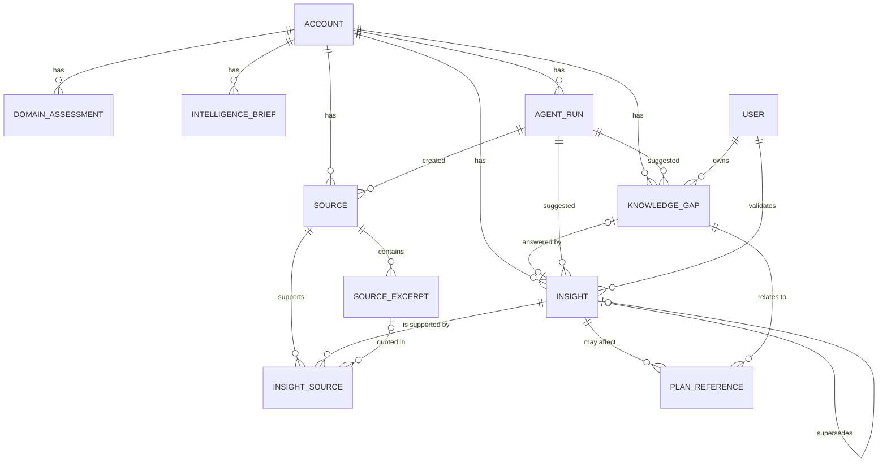

# MATILDA Customer Intelligence

> Module specification for building the MATILDA prototype.
> Read together with `CLAUDE.md`, `data-model.md` and `account-plan.md`.
> This file is the source of truth for the Customer Intelligence module. Where it is more specific than `data-model.md`, follow this file.

---

## 0. Instructions for Claude

- Build **V1 as described here**: four sub-pages, six intelligence domains, one review queue. Do not add the extended domain model (8+ domains, maturity scoring, intelligence graphs) unless asked.
- Reuse the core domain objects: **Account, Source, Insight, Knowledge Gap**. Only the supporting objects defined in section 7 may be added. Do not invent new domain objects.
- Keep the distinction **Fact ≠ Observation ≠ Hypothesis ≠ AI Inference** visible everywhere an Insight is shown.
- **AI suggests, humans decide.** Agent output always starts as `needs_validation`, never as `validated`.
- Every Insight must link to at least one Source, unless it is explicitly a user Observation or a Hypothesis.
- Mock the agent in the prototype (seeded suggestions + a "Run agent" button that adds pre-made suggestions). Do not build real crawling unless asked.
- Preserve the demo flow in section 12.

---

## 1. Purpose

Customer Intelligence is where MATILDA builds and maintains **NOVA's shared understanding of the customer**.

It answers seven questions:

1. What do we know about the customer?
2. What have we recently learned?
3. What has changed?
4. How certain are we?
5. What do we not know?
6. What does this mean for NOVA?
7. Which parts of the Account Plan may be affected?

### Position in MATILDA

| Module | Role |
|---|---|
| **Customer Intelligence** | Understand the customer |
| Account Plan | Choose how NOVA will develop the customer |
| Relationships | Understand and develop relevant people and relationships |
| Opportunities | Develop concrete commercial opportunities |

Customer Intelligence feeds the other modules. It does **not** contain goals, initiatives or actions; it contains the evidence and understanding those are built on.

### Core idea

> **Sources are the raw material. Customer Intelligence is what MATILDA derives and structures from the raw material.**

The user does not "upload to Customer Intelligence". The user (or the agent) adds **Sources**; MATILDA analyses them and **suggests Insights**; a human validates them.

```text
Source  ──►  Suggested Insight  ──►  Human review  ──►  Validated Insight  ──►  Used in Account Plan / Overview
   │                                                          │
   └──────────────►  Knowledge Gap (what we still don't know) ◄┘
```

---

## 2. Design principles

| Principle | Meaning in this module |
|---|---|
| Living Account Model | Intelligence is continuously updated, never a static report |
| Capture once, reuse everywhere | An Insight is stored once and referenced by Account Plan, Overview, Relationships |
| Source before assertion | Important claims are traceable to Sources |
| Expose uncertainty | Confidence, type and freshness are always visible |
| Easy contribution | Adding a document, URL or note takes under 30 seconds |
| Human in control | Agent suggestions require human acceptance |
| Simple first | V1 favours clarity and ease of updating over completeness |

---

## 3. Module structure (V1)

Customer Intelligence has four sub-pages:

```text
CUSTOMER INTELLIGENCE

1. OVERVIEW         What do we understand? What changed? What is uncertain?
2. INSIGHTS         What do we currently believe?
                    Facts · Observations · Hypotheses · AI Inferences
3. SOURCES          Why do we believe it?
                    Documents · URLs · Meetings · Notes
4. KNOWLEDGE GAPS   What don't we know?
                    Questions · Importance · Owner · Status
```

A **Review queue** (agent suggestions awaiting decision) is shown as a panel on Overview and as a filter on Insights. It is not a separate page.

---

## 4. Intelligence domains (V1)

V1 uses **seven domains**. Every Insight and Knowledge Gap belongs to exactly one domain.
`partners_competition` was added when `knowledge-gaps.md` named it as a needed category —
see `data-model.md` "intelligence_domain" for why it was added here rather than kept as a
separate classification.

| Key | Domain | Typical content | Agent can collect automatically | Human contribution |
|---|---|---|---|---|
| `company_business` | Company & Business | Business description, business areas, products/services, geographies, segments, revenue and key figures, employees, market position, competitors, M&A | High | Low |
| `strategy_priorities` | Strategy & Priorities | Strategic goals, priorities, transformation programmes, investment areas, what has been deprioritised, changes since last period | High | Validation |
| `organisation_leadership` | Organisation & Leadership | CEO and executive team, CIO/CTO/CDO, digital leaders, structure, major reorganisations, new leadership hires | High | Relational context (who really decides) |
| `technology_digital` | Technology & Digital Agenda | Technology partners, platform choices, cloud, data, AI programmes, commerce, CX, security, modernisation, announced investments | Fairly high | Validation |
| `news_changes` | News & Key Changes | Press releases, leadership changes, results, partnerships, contracts, reorganisations, regulatory and market events | Very high | Low |
| `nova_customer` | NOVA & Customer | What NOVA delivers today, project history, proposals, satisfaction signals, internal knowledge | From internal sources | Important |
| `partners_competition` | Partners & Competition | Technology/delivery partners, competitive position, incumbent vendors, alliances | Fairly high | Important |

### Domain status

Each domain has a computed status shown on Overview:

| Status | Rule (prototype heuristic) |
|---|---|
| `strong` | ≥ 5 validated Insights, at least one Fact, no high-priority open Gap, newest validated Insight < 90 days |
| `partial` | 2–4 validated Insights, or ≥ 1 high-priority open Gap |
| `limited` | 0–1 validated Insights |
| `stale` | Has Insights, but newest validated Insight > 180 days old |

Users may override the computed status with a short reason (`statusOverride`, `statusOverrideReason`). Show that an override is active.

---

## 5. Sub-page specifications

### 5.1 Overview

**Purpose:** In 30 seconds, show how well NOVA understands the customer, what has changed and what needs attention.

**Content, top to bottom:**

1. **Intelligence Brief** (AI-generated, labelled as AI Inference)
   3–5 sentences: current understanding, most important recent changes, biggest uncertainty. Each sentence links to the Insights it builds on. Shows `generatedAt` and a "Regenerate" button.

2. **Domain status table**

   | Domain | Status | Recent change | Open gaps | Last updated |
   |---|---|---|---|---|
   | Company & Business | Strong | → | 1 | 12 Nov |
   | Strategy & Priorities | Strong | ↑ | 1 | 24 Nov |
   | Organisation & Leadership | Partial | ↑ | 3 | 20 Nov |
   | Technology & Digital Agenda | Partial | ↑↑ | 4 | 22 Nov |
   | News & Key Changes | Strong | ↑ | 0 | 25 Nov |
   | NOVA & Customer | Strong | → | 1 | 18 Nov |

   "Recent change" = number of newly validated or changed Insights in the last 30 days (→ 0, ↑ 1–2, ↑↑ 3+). Clicking a row opens Insights filtered on the domain.

3. **What changed** – the 5 most recent significant changes (new/changed/superseded Insights with `importance = high`), each with date, domain and Source.

4. **Review queue** – count and top 3 agent suggestions awaiting review, with Accept / Edit / Reject inline.

5. **Most important Knowledge Gaps** – top 3 open Gaps by importance, with owner.

6. **Possible impact on Account Plan** – Insights flagged `affectsAccountPlan`, with which plan element may be affected (Goal, Initiative, Assumption, Risk). Action: "Open in Account Plan".

**Must not contain:** revenue charts, pipeline, activity counts, CRM-style KPI cards.

### 5.2 Insights

**Purpose:** The current, validated understanding of the customer, and the queue of suggestions.

**Layout:** list grouped by domain, with filters:
- Domain
- Type: Fact / Observation / Hypothesis / AI Inference
- Status: Needs Validation / Validated / Disputed / Superseded / Rejected (default: Validated + Needs Validation)
- Confidence: High / Medium / Low
- Importance
- Origin: Agent / User
- "Affects Account Plan"

**Insight card shows:**
- Statement (one or two sentences)
- Type badge (visually distinct per type; AI Inference always marked with an AI icon)
- Confidence, Importance
- Domain
- Sources (count + names, click to open)
- Status and who validated it / when
- "So what for NOVA" (optional, short)
- Freshness indicator (age since `observedAt` or last validation)

**Actions on an Insight:**
- Accept (needs validation → validated)
- Edit then accept
- Reject (with optional reason)
- Mark as disputed
- Supersede (create new Insight that replaces this one; old one keeps history)
- Change type (e.g. Hypothesis → Fact when confirmed)
- Link to Knowledge Gap ("this answers gap X")
- Flag as affecting Account Plan

**Add Insight manually:** statement, type, domain, confidence, optional Sources. A manual Insight of type `observation` or `hypothesis` may have zero Sources; `fact` requires at least one.

### 5.3 Sources

**Purpose:** The evidence base. Where users add material and see what MATILDA has derived from it.

**Top of page: "Add source"** with three options:

| Option | Input | Example |
|---|---|---|
| Upload document | PDF, PPTX, DOCX, XLSX | Customer strategy, annual report, workshop output |
| Add URL | URL + optional "monitor for changes" | Investor page, press release, partner case |
| Add note | Free text + date + optional people involved | "Kari said in the meeting that the new CIO will review the sourcing model." |

After adding: status goes `pending → analysing → analysed`, and the user is shown "MATILDA found N possible Insights" with a link to review them.

**Source list:**

| Source | Type | Category | Added | Insights | Status |
|---|---|---|---|---|---|
| Strategy 2030 | PDF | Customer document | 24 Nov | 7 | Analysed |
| Annual Report 2025 | URL | Annual report | Auto | 12 | Monitored |
| Customer meeting 22 Nov | Note | Meeting | 22 Nov | 3 | Validated |
| AI announcement | URL | Press release | Auto · 20 Nov | 2 | Analysed |
| Platform strategy | PPTX | Customer document | 14 Nov | 5 | Analysed |

**Source categories (grouped):**

- **External:** Website, Annual report, Press release, News article, Investor presentation, Partner case, Job posting, Public report
- **Internal NOVA:** SharePoint document, Teams conversation, Proposal, Project report, Account Plan, CRM record
- **Direct contact:** Meeting, Meeting transcript, Email, Workshop, User observation

**Source detail view:** metadata, summary, extracted excerpts, list of Insights derived (with status), re-analyse button, and for URLs the monitoring status and last checked time.

**Rules:**
- Sources are never edited after analysis, only re-analysed or archived. Archiving does not delete linked Insights but marks them "source archived".
- Reliability is set per Source (`high` / `medium` / `low`), defaulted by category (annual report = high, news article = medium, job posting = low).
- Internal and direct-contact Sources are marked `internal` and must never be shown in customer-facing outputs.

### 5.4 Knowledge Gaps

**Purpose:** Make explicit what NOVA does not know, and assign responsibility for finding out.

**Each Gap is an answerable question**, e.g. "Who owns the budget for the AI programme?", not "AI".

**List columns:** Question · Domain · Importance · Owner · Due · Status · Linked Account Plan element

**Statuses:** `open → investigating → answered` or `closed_unanswerable`

**Answering a Gap:** the user selects or creates the Insight that answers it. The Gap becomes `answered` and links to the Insight.

**Gap sources:**
- Created manually
- Suggested by the agent (e.g. domain with few Insights, contradictory Insights, Hypothesis with high importance)
- Created from the Account Plan (Assumptions, Validation priorities)

**Rule:** every `high`-importance Gap must have an owner. Overview flags violations.

---

## 6. The Intelligence Agent

### 6.1 What the agent does

| Job | Trigger | Output |
|---|---|---|
| **Analyse source** | New Source added, or re-analyse | Summary, excerpts, suggested Insights |
| **Monitor** | Scheduled (prototype: manual "Run agent") | New Sources from monitored URLs and news; suggested Insights |
| **Detect change** | New suggestion contradicts or updates an existing validated Insight | Suggestion flagged as `update` or `contradiction`, linked to the existing Insight |
| **Suggest gaps** | After analysis or domain status change | Suggested Knowledge Gaps |
| **Write brief** | On request or after review | Intelligence Brief on Overview |
| **Flag plan impact** | Suggestion relates to Goal/Initiative/Assumption/Risk | `affectsAccountPlan` + reference |

### 6.2 What the agent can collect automatically

- **External, public:** customer website, annual reports, investor presentations, press releases, Capital Markets Day material, executive interviews, partner case studies (Microsoft/AWS/Google, platform vendors), conference talks, job postings (as a signal of capability build-up, e.g. "Head of AI Platform", "Enterprise Data Architect"), public company data, news.
- **Internal NOVA (later versions):** Teams, SharePoint, meeting notes and transcripts, email, account plans, proposals, project material, CRM, later financial data.

V1 prototype: external sources mocked with seeded data; internal sources represented by manually added Sources.

### 6.3 Agent rules

1. All agent output has `origin = agent` and `status = needs_validation`.
2. Agent-generated Insights are typed `fact` only when directly stated in a Source with reliability `high`; otherwise `ai_inference`.
3. Every agent Insight links to the Source and excerpt it is based on.
4. The agent never changes or deletes a validated Insight. It suggests a superseding Insight instead.
5. The agent never generates Insights about named individuals' personal lives; only professional role, responsibility and public statements.
6. Duplicate check: if a suggestion is semantically equal to an existing Insight, link the new Source to the existing Insight (strengthening evidence) instead of creating a new one.
7. Each suggestion carries a short rationale ("Why MATILDA suggests this").

---

## 7. Data model

### 7.1 Overview

Core objects (shared with the rest of MATILDA): **Account, Source, Insight, KnowledgeGap**.
Supporting objects for this module: **SourceExcerpt, InsightSource, DomainAssessment, AgentRun, IntelligenceBrief, PlanReference**.



### 7.2 Enums

```ts
type IntelligenceDomain =
  | 'company_business'
  | 'strategy_priorities'
  | 'organisation_leadership'
  | 'technology_digital'
  | 'news_changes'
  | 'nova_customer'
  | 'partners_competition';

type InsightType = 'fact' | 'observation' | 'hypothesis' | 'ai_inference';
// Shared with the rest of MATILDA — see data-model.md "insight_status". Not stored:
// freshness ('fresh' | 'ageing' | 'stale') is always computed from observed_at/validated_at.
type InsightStatus = 'needs_validation' | 'validated' | 'disputed' | 'superseded' | 'rejected';
type SuggestionKind = 'new' | 'update' | 'contradiction';   // only for agent suggestions
type Level = 'high' | 'medium' | 'low';                      // confidence, reliability
type ImportanceLevel = 'critical' | 'high' | 'medium' | 'low'; // shared with the rest of MATILDA
type Origin = 'agent' | 'user';

type SourceKind = 'document' | 'url' | 'note';
type SourceCategory =
  // external
  | 'website' | 'annual_report' | 'press_release' | 'news_article'
  | 'investor_presentation' | 'partner_case' | 'job_posting' | 'public_report'
  // internal NOVA
  | 'sharepoint_document' | 'teams_conversation' | 'proposal' | 'project_report'
  | 'account_plan' | 'crm_record'
  // direct contact
  | 'meeting' | 'meeting_transcript' | 'email' | 'workshop' | 'user_observation';
type SourceStatus = 'pending' | 'analysing' | 'analysed' | 'monitored' | 'failed' | 'archived';
type Visibility = 'public' | 'internal';

// Shared with the rest of MATILDA — see data-model.md "knowledge_gap_status".
type GapStatus = 'open' | 'investigating' | 'answered' | 'closed_unanswerable';
type DomainStatus = 'strong' | 'partial' | 'limited' | 'stale';
type PlanElementType = 'goal' | 'initiative' | 'assumption' | 'risk' | 'relationship' | 'opportunity';
type AgentJob = 'analyse_source' | 'monitor' | 'detect_change' | 'suggest_gaps' | 'write_brief';
```

### 7.3 Entities

```ts
interface Account {            // shared object; only fields used by this module
  id: string;
  name: string;                // "DNV"
  website?: string;
  industry?: string;
  accountType: 'kam' | 'tam';
}

interface Source {
  id: string;
  accountId: string;
  title: string;
  kind: SourceKind;
  category: SourceCategory;
  visibility: Visibility;      // derived from category; internal/direct = 'internal'
  reliability: Level;          // defaulted from category, editable
  url?: string;                // kind = 'url'
  fileName?: string;           // kind = 'document'
  fileType?: 'pdf' | 'pptx' | 'docx' | 'xlsx';
  noteText?: string;           // kind = 'note'
  participants?: string[];     // notes/meetings: people involved
  publishedAt?: string;        // date of the content itself (ISO)
  addedAt: string;
  addedBy: string;             // userId or 'agent'
  origin: Origin;
  agentRunId?: string;
  monitor: boolean;            // URL watched for changes
  lastCheckedAt?: string;
  status: SourceStatus;
  summary?: string;            // AI summary of the source
  domains: IntelligenceDomain[]; // domains the source touches
}

interface SourceExcerpt {
  id: string;
  sourceId: string;
  text: string;                // short quote or extracted passage
  location?: string;           // "p. 12", "slide 4", "00:14:32"
}

interface Insight {
  id: string;
  accountId: string;
  domain: IntelligenceDomain;
  statement: string;           // 1–2 sentences
  type: InsightType;
  confidence: Level;
  status: InsightStatus;
  importance: ImportanceLevel;
  origin: Origin;
  suggestionKind?: SuggestionKind;   // agent suggestions only
  relatedInsightId?: string;         // the Insight an 'update'/'contradiction' refers to
  rationale?: string;          // why the agent suggests it
  soWhat?: string;             // what this means for NOVA
  observedAt: string;          // when the underlying information is from
  createdAt: string;
  createdBy: string;           // userId or 'agent'
  agentRunId?: string;
  validatedAt?: string;
  validatedBy?: string;
  rejectedReason?: string;     // required when status = 'rejected'
  supersedesId?: string;
  supersededById?: string;
  affectsAccountPlan: boolean;
  tags?: string[];             // e.g. 'AI', 'Leadership', 'Acquisition'
}

interface InsightSource {      // many-to-many Insight ↔ Source
  insightId: string;
  sourceId: string;
  excerptId?: string;
  relation: 'supports' | 'contradicts';
}

interface KnowledgeGap {
  id: string;
  accountId: string;
  domain: IntelligenceDomain;
  question: string;            // must be phrased as a question
  whyItMatters?: string;
  importance: ImportanceLevel;
  ownerId?: string;            // required when importance = 'high'
  dueDate?: string;
  status: GapStatus;
  // More detailed than Origin — see data-model.md "gap_creation_type". Agent-suggested
  // gaps start as status 'open' with creationType 'matilda_suggested' and need acceptance.
  creationType: 'human_manual' | 'human_contextual' | 'matilda_suggested' | 'account_review';
  accepted: boolean;           // false = agent suggestion not yet accepted
  answeredByInsightId?: string;
  goalIds: string[];
  initiativeIds: string[];
  relationshipIds: string[];
  opportunityIds: string[];
  reviewIds: string[];
  actionIds: string[];
  createdAt: string;
  createdBy: string;
}

interface PlanReference {      // link to Account Plan elements; no plan content copied here
  id: string;
  fromType: 'insight' | 'knowledge_gap';
  fromId: string;
  planElementType: PlanElementType;
  planElementId: string;
  note?: string;               // "May require review of Goal 2"
}

interface DomainAssessment {   // one per account per domain
  accountId: string;
  domain: IntelligenceDomain;
  computedStatus: DomainStatus;
  statusOverride?: DomainStatus;
  statusOverrideReason?: string;
  validatedInsightCount: number;
  openGapCount: number;
  recentChangeCount: number;   // last 30 days
  lastUpdatedAt?: string;
}

interface IntelligenceBrief {
  id: string;
  accountId: string;
  text: string;
  basedOnInsightIds: string[];
  generatedAt: string;
}

interface AgentRun {
  id: string;
  accountId: string;
  job: AgentJob;
  startedAt: string;
  finishedAt?: string;
  status: 'running' | 'completed' | 'failed';
  sourcesCreated: number;
  insightsSuggested: number;
  gapsSuggested: number;
}
```

### 7.4 Invariants (enforce in code)

1. `Insight.type = 'fact'` ⇒ at least one `InsightSource` with `relation = 'supports'`.
2. `Insight.origin = 'agent'` ⇒ created with `status = 'needs_validation'`.
3. `status = 'validated'` ⇒ `validatedBy` and `validatedAt` set.
4. `status = 'superseded'` ⇒ `supersededById` set; the superseding Insight has `supersedesId`.
5. `KnowledgeGap.importance = 'high'` and `accepted` ⇒ `ownerId` should be set (warn, do not block).
6. `KnowledgeGap.status = 'answered'` ⇒ `answeredByInsightId` set.
7. `Source.visibility = 'internal'` ⇒ never included in customer-facing exports.
8. `DomainAssessment` is derived; recompute on every Insight/Gap change. Only override fields are stored by users.
9. Account Plan content is never copied into this module; only `PlanReference` links.

### 7.5 Derived values

- **Freshness** of an Insight: `fresh` < 90 days, `ageing` 90–180, `stale` > 180 (from `validatedAt ?? observedAt`).
- **Evidence strength**: number of supporting Sources weighted by reliability (high = 3, medium = 2, low = 1). Show as dots, not a number.
- **Contradiction flag**: any `InsightSource.relation = 'contradicts'` or an open `contradiction` suggestion.

---

## 8. Key user flows

### 8.1 Add a document
1. Sources → Add source → Upload document (choose category).
2. Status `analysing` → `analysed`.
3. Toast: "MATILDA found 5 possible Insights and 1 Knowledge Gap." → Review.
4. User accepts 3, edits 1, rejects 1. Domain statuses and Overview update.

### 8.2 Add a note after a customer meeting
1. Add source → Add note: text, date, participants.
2. MATILDA suggests an Insight typed `observation` (direct contact) and, if relevant, flags that it answers an open Knowledge Gap.
3. User accepts; Gap becomes `answered`.

### 8.3 Agent finds a change
1. Agent run (monitor) finds a press release: new Chief Digital Officer appointed.
2. Suggestion with `suggestionKind = 'update'` linked to existing Insight "CIO owns digital agenda".
3. Overview shows it under *What changed* and *Review queue*, with plan impact on the Relationship Strategy.
4. User accepts: old Insight `superseded`, new Insight `validated`, PlanReference created.

### 8.4 Close a Knowledge Gap
1. Knowledge Gaps → open Gap "Who owns the AI budget?"
2. "Answer with Insight" → choose existing or create new.
3. Gap `answered`; domain status recomputed.

---

## 9. KAM vs TAM

| Aspect | KAM (4–5 customers) | TAM (20–25 customers) |
|---|---|---|
| Domains | All six, full depth | All six, with focus on News & Key Changes and NOVA & Customer |
| Agent monitoring | Frequent, broad | Lighter; highlight only `importance = high` changes |
| Knowledge Gaps | Actively managed with owners | Optional; top 3 only |
| Brief | Full | Short (2–3 sentences) |

Same data model for both; only defaults and UI density differ (`Account.accountType`).

---

## 10. UI rules

- Type badges: Fact (solid), Observation (outlined), Hypothesis (dashed/question mark), AI Inference (AI icon). Never rely on colour alone.
- Suggested items have a clear "Suggested by MATILDA" label and inline Accept / Edit / Reject.
- Always show Source count and freshness on Insight cards.
- Internal Sources show a lock icon.
- Empty states invite contribution: "No Insights about Organisation & Leadership yet. Add a source or a note."
- Keep the language plain; avoid scores and percentages for confidence.

---

## 11. Out of scope for V1

- Real web crawling, scheduled jobs and integrations with Teams/SharePoint/CRM (mock them)
- Extended domain model (8+ domains, sub-domains, maturity scores)
- Full-text search across documents
- Relationship mapping (belongs to the Relationships module)
- Goals, Initiatives, Actions (belong to Account Plan)
- Permissions beyond "internal source" visibility
- Versioned document storage

---

## 12. Demo scenario (seed data, illustrative)

Account: **Nordic Horizon Group** (the same fictional canonical Account used throughout MATILDA — see `demo-scenario.md`). All content below is illustrative prototype data, not verified facts about any real organisation.

**Seed:**
- 8 Sources: Group 2026 digital ambition statement (PDF — the same Source already seeded for Account Plan), Annual report (URL, monitored), Investor presentation (URL), Platform strategy deck (PPTX), Customer meeting 22 Nov (note), NOVA proposal notes (internal), Press release on the data platform direction, Job posting "Head of Data Platform".
- ~25 Insights across all seven domains, mixed types; 3 in `needs_validation`.
- 6 Knowledge Gaps, 2 high importance (one without owner, to trigger the warning) — may reuse the three already seeded for Account Plan (decision owner, funding, scope).
- 2 PlanReferences to Account Plan (the existing Goal and Initiative).

**Demo flow (must work end to end):**
1. Open Nordic Horizon Group → Customer Intelligence → Overview: brief, domain table, what changed.
2. Review queue: accept a suggested Insight about the data platform programme; see Technology & Digital Agenda move from Partial to Strong.
3. Sources → Add note from a customer meeting → MATILDA suggests an Observation that answers "Who owns the platform decision?" → accept → Gap answered.
4. Click "Run agent" → a new press release appears with an `update` suggestion about leadership → accept → old Insight superseded; plan impact shown.
5. From an Insight, navigate to its Sources and excerpt; from Overview, open the affected Account Plan element.

---

## 13. Acceptance criteria

1. The four sub-pages exist and are reachable from the Account page.
2. A user can add a document, URL or note in under 30 seconds.
3. Adding a Source produces suggested Insights linked to that Source and excerpt.
4. Suggestions can be accepted, edited, rejected; validated Insights record who and when.
5. Every Insight shows type, confidence, importance, domain, Source count and freshness.
6. A `fact` cannot be saved without a supporting Source.
7. Superseding keeps history and links old and new Insight.
8. Domain status is computed per section 4 and can be overridden with a reason.
9. Knowledge Gaps can be created, assigned, answered by an Insight; high-importance Gaps without owner are flagged.
10. Overview shows brief, domain table, what changed, review queue, top gaps and plan impact.
11. Internal Sources are visibly marked.
12. The demo flow in section 12 runs without errors.

---

## 14. North-star test

> After five minutes in Customer Intelligence, a KAM should be able to say: **what we know about the customer, what has changed, how sure we are, what we don't know, and what it means for our plan**, and point to the evidence for each.
