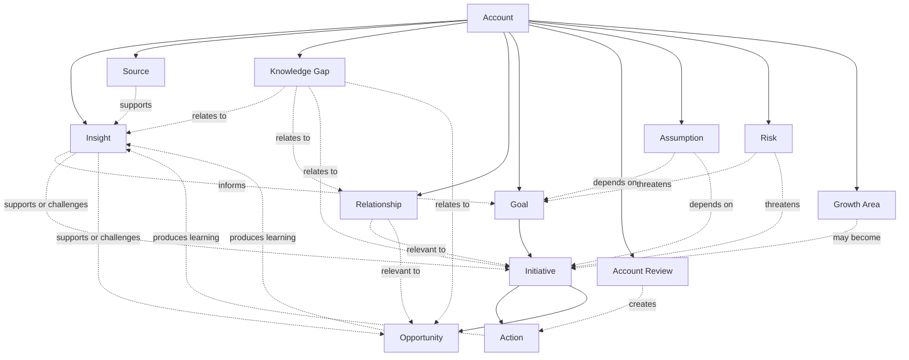

# MATILDA Logical Data Model

## Purpose

This document defines the implementation-neutral logical schema for the prototype: entities, fields, relationships, enums, and validation rules.

The core domain contains thirteen entities:

1. Account
2. Insight
3. Source
4. Knowledge Gap
5. Relationship
6. Goal
7. Initiative
8. Action
9. Opportunity
10. Account Review
11. Assumption
12. Risk
13. Growth Area

Assumption, Risk, and Growth Area were added when `account-plan.md` was written out in
full (see that document's chapters 6 and 10): the Account Plan needs to show conditions
the strategy depends on, threats to the strategy, and candidate areas of potential that
are not yet (and may never become) an Initiative. None of these can be represented
cleanly by an existing entity — an Assumption is not an open question (`KnowledgeGap`),
a Risk is not customer knowledge (`Insight`), and a Growth Area can exist, and be
rejected, without ever becoming coordinated work (`Initiative`).

The Customer Intelligence module (`customer-intelligence.md`) adds three further supporting
entities — **Agent Run**, **Intelligence Brief**, and **Account Domain Override** — plus new
fields and join tables on `Source`, `Insight`, and `Knowledge Gap`. These are supporting
objects, not additional core entities, in the same sense `InsightSource` and
`OpportunityQualification` already are.

A physical schema may add junction tables, indexes, and technical metadata without changing this domain meaning.

## Modelling principles

- `Account` is the root entity.
- `Insight` is the atomic unit of Account knowledge.
- Important Insights are connected to Sources.
- Unknowns are represented explicitly as Knowledge Gaps.
- Account Plan is a view over structured entities, not a document entity.
- Account Review is primarily a generated decision view.
- Initiative and Opportunity are distinct.
- AI proposals and validated human knowledge must remain distinguishable.
- Material changes should be traceable over time.
- Avoid new domain objects unless required by actual prototype behaviour.

## Conceptual relationships

All cross-links must remain within the same Account.

## Common conventions

### Identifiers

Use stable opaque identifiers such as UUIDs. Human-readable prefixes may be added for demo display, for example `INS-018`, but display IDs must not be relied on as database keys.

### Timestamps

Store timestamps in UTC and render them in the user's locale. Use ISO 8601 at integration boundaries.

### Audit metadata

Where relevant, entities should include:

| Field | Type | Required | Notes |
|---|---|---:|---|
| `created_at` | datetime | Yes | Immutable creation time |
| `created_by` | string/user reference | Yes | Human or service identity |
| `updated_at` | datetime | Yes | Last material update |
| `updated_by` | string/user reference | Yes | Human or service identity |
| `origin_type` | enum | Yes | `human`, `matilda_suggestion`, `import`, `system` |
| `ai_generated` | boolean | Yes | True when initial content was AI-generated |

Do not use one generic AI data table. AI metadata belongs with the affected records and proposal history.

### Optional values

Use `null` for unknown values. Do not convert unknown into false, zero, or “not applicable.” Where the distinction matters, model `unknown` and `not_applicable` explicitly.

## Enums

### `information_type`

- `fact`
- `observation`
- `hypothesis`
- `ai_inference`

`decision` is conceptually a separate human-approved result, not an Insight type in the initial physical model. Review decisions may be stored within Account Review until a dedicated Decision entity is justified.

### `insight_status`

- `needs_validation`
- `validated`
- `disputed`
- `superseded`
- `rejected`

Freshness (`fresh` / `ageing` / `stale`) is a **computed** value derived from `observed_at` /
`validated_at`, not a stored status — see "Freshness" below. An earlier version of this
document stored `stale` as a status value; that conflated two different concerns (is this
knowledge still validated? vs. is it due for revalidation?) and a validated Insight could not
be both current and overdue for review at the same time. `disputed` and `rejected` were added
when `customer-intelligence.md` introduced agent-suggested Insights: a human must be able to
reject a suggestion, or dispute a previously validated Insight, without the record disappearing.

### `confidence_level`

- `low`
- `medium`
- `high`

Confidence does not replace evidence or validation status.

### `importance_level`

- `low`
- `medium`
- `high`
- `critical`

### `knowledge_gap_status`

- `open`
- `investigating`
- `answered`
- `closed_unanswerable`

Renamed from `resolved` to `answered` (plus the new `closed_unanswerable`) when
`customer-intelligence.md` made explicit that a Gap can close two different ways: a human
found the answer (`answered`, linked to the Insight that answers it) or the team concluded it
cannot be answered right now (`closed_unanswerable`). Both are a form of closure, but they call
for different follow-up, so one combined `resolved` value was not precise enough.

### `relationship_strength`

- `unknown`
- `weak`
- `developing`
- `strong`

### `goal_status`

- `proposed`
- `active`
- `at_risk`
- `achieved`
- `stopped`

### `initiative_status`

- `proposed`
- `active`
- `on_hold`
- `completed`
- `stopped`

### `action_status`

- `proposed`
- `planned`
- `in_progress`
- `completed`
- `cancelled`

`overdue` should normally be derived from `due_date < now` and an incomplete status rather than stored.

### `opportunity_stage`

- `potential`
- `validating`
- `qualified`
- `proposal`
- `negotiation`
- `won`
- `lost`

### `qualification_state`

- `confirmed`
- `uncertain`
- `missing`
- `not_applicable`

### `intelligence_domain`

Introduced for the Customer Intelligence module (`customer-intelligence.md`). Replaces the
free-text `topic` field on `Insight` and `Knowledge Gap` with a fixed, filterable set — every
Insight and Knowledge Gap belongs to exactly one domain. `partners_competition` was added
when `knowledge-gaps.md` proposed its own, separate four-value `area` for Knowledge Gaps
(`organization_governance`, `technology_digital`, `partners_competition`, `nova_position`) —
rather than maintain two competing classifications of the same kind of thing, Knowledge Gaps
use this one set too, extended with the one genuinely new category it named.

- `company_business`
- `strategy_priorities`
- `organisation_leadership`
- `technology_digital`
- `news_changes`
- `nova_customer`
- `partners_competition`

### `source_kind`

- `document`
- `url`
- `note`

### `source_category`

Grouped as external (`website`, `annual_report`, `press_release`, `news_article`,
`investor_presentation`, `partner_case`, `job_posting`, `public_report`), internal NOVA
(`sharepoint_document`, `teams_conversation`, `proposal`, `project_report`, `account_plan`,
`crm_record`), and direct contact (`meeting`, `meeting_transcript`, `email`, `workshop`,
`user_observation`).

### `source_visibility`

- `public`
- `internal` — internal and direct-contact Sources; must never appear in customer-facing output.

### `source_status`

- `pending`
- `analysing`
- `analysed`
- `monitored`
- `failed`
- `archived`

### `suggestion_kind`

Only set on agent-originated Insights or Knowledge Gaps.

- `new`
- `update`
- `contradiction`

### `agent_job`

- `analyse_source`
- `monitor`
- `detect_change`
- `suggest_gaps`
- `write_brief`

### `agent_run_status`

- `running`
- `completed`
- `failed`

### `domain_status`

Computed, not normally stored (see "Domain status" under Insight below) — only a human
`status_override` is persisted.

- `strong`
- `partial`
- `limited`
- `stale`

### `review_status`

- `draft`
- `in_review`
- `finalised`

### `assumption_status`

- `unvalidated`
- `confirmed`
- `invalidated`

### `risk_level`

Used for both `likelihood` and `impact` on a Risk.

- `low`
- `medium`
- `high`

### `growth_posture`

- `pursue`
- `monitor`
- `reject`

## Account

Represents the customer organisation and root of the living model.

| Field | Type | Required | Validation / meaning |
|---|---|---:|---|
| `id` | UUID | Yes | Primary key |
| `name` | string | Yes | Unique within the prototype unless duplicate legal entities are intentional |
| `account_type` | string/enum | No | Example: strategic, KAM, TAM, other |
| `segment` | string | No | Business-defined segment |
| `industry` | string | No | Plain-language industry |
| `account_manager` | user reference | Yes | Overall accountable owner |
| `technical_account_manager` | user reference | No | When relevant |
| `account_team` | user-reference list | No | Contributors |
| `ambition` | text | No | NOVA's overall ambition for the Account |
| `time_horizon` | string | No | Free text, e.g. "12-36 months" (account-plan.md §4) |
| `plan_status` | enum | Yes | Status of the Account Plan itself — not any single Goal. Default `draft` |
| `review_due_at` | datetime | No | Target date for the next Account Plan review |
| `strategic_status` | string/enum | No | Keep initial values simple |
| `last_reviewed_at` | datetime | No | Last Account-level review |
| common audit fields | — | Yes | As above |

### `plan_status`

- `draft`
- `active`
- `needs_review`
- `retired`

### Rules

- Every core record belongs to exactly one Account.
- Account deletion should be restricted or implemented only as a full demo reset.
- Synthetic demo Accounts must be clearly marked in the UI or seed metadata.

## Insight

Represents one discrete claim or piece of knowledge about an Account.

| Field | Type | Required | Validation / meaning |
|---|---|---:|---|
| `id` | UUID | Yes | Primary key |
| `account_id` | UUID/FK | Yes | Parent Account |
| `title` | string | Yes | Short scannable label |
| `statement` | text | Yes | One atomic claim where practical |
| `domain` | enum | Yes | One of six Intelligence Domains (`customer-intelligence.md` §4); replaces the earlier free-text `topic` |
| `information_type` | enum | Yes | Fact, Observation, Hypothesis, or AI Inference |
| `status` | enum | Yes | Insight status |
| `importance` | enum | Yes | Strategic relevance |
| `confidence` | enum | Yes | Explicit, not implied by type |
| `observed_at` | datetime/date | Yes | When the information applied or was observed |
| `validated_at` | datetime | No | Required when status becomes validated |
| `validated_by` | user reference | No | Required with `validated_at` |
| `rejected_reason` | text | No | Required when status is `rejected` |
| `last_reviewed_at` | datetime | No | Last freshness review |
| `review_due_at` | datetime | No | Optional freshness threshold |
| `supersedes_insight_id` | UUID/FK | No | Previous Insight if this replaces it |
| `related_insight_id` | UUID/FK | No | For an `update`/`contradiction` suggestion: the Insight it refers to |
| `suggestion_kind` | enum | No | Set only on agent-originated Insights |
| `rationale` | text | No | Why the agent suggests it |
| `so_what` | text | No | What this means for NOVA |
| `affects_account_plan` | boolean | Yes | Default false; flags the Insight for attention even before a formal Goal/Initiative/Opportunity link exists |
| `agent_run_id` | UUID/FK | No | The Agent Run that produced this Insight, if any |
| common audit fields | — | Yes | As above |

### Domain status

Each Intelligence Domain has a status (`strong` / `partial` / `limited` / `stale`) shown on
the Customer Intelligence Overview. It is **computed on read** from the Account's Insights and
Knowledge Gaps in that domain (see `customer-intelligence.md` §4 for the exact heuristic), not
stored — storing it would create a second value that could drift from the Insights it
summarises. A human may record an explicit override (`AccountDomainOverride` below); the
override, and only the override, is persisted.

### Rules

- Prefer one claim per Insight. Split compound statements.
- `ai_inference` requires `ai_generated = true`.
- `validated` requires `validated_at` and `validated_by`.
- `rejected` requires a reason; `disputed` should record who disputed it and why.
- Changing `information_type` to `fact` requires human validation and at least one Source or explicit user-origin rationale.
- Superseded Insights remain queryable for history.
- Staleness (computed, see "Freshness") does not mean false; it means revalidation may be needed, and does not change `status`.

## Source

Represents evidence or origin for customer intelligence. Extended for the Customer
Intelligence module (`customer-intelligence.md` §5.3, §7) — `kind`/`category` replace the
earlier free-text `source_type`/`classification`.

| Field | Type | Required | Validation / meaning |
|---|---|---:|---|
| `id` | UUID | Yes | Primary key |
| `account_id` | UUID/FK | Yes | Parent Account |
| `title` | string | Yes | Human-readable Source title |
| `kind` | enum | Yes | Document, URL, or note |
| `category` | enum | Yes | Defaults `visibility` and `reliability` (editable) |
| `visibility` | enum | Yes | `internal` Sources must never appear in customer-facing output |
| `reliability` | enum | Yes | Confidence-scale reuse: high/medium/low |
| `url` | string | No | `kind = url` |
| `file_name` / `file_type` | string | No | `kind = document`; metadata only — the prototype does not store or parse the actual file |
| `note_text` | text | No | `kind = note` |
| `participants` | string | No | Comma-separated, for notes/meetings |
| `source_date` | datetime/date | No | Date of the underlying content |
| `owner` | user/string | No | Source owner or contact |
| `origin_type` | enum | Yes | Reuses the common `origin_type` enum |
| `monitor` | boolean | Yes | Default false; URL watched for changes |
| `last_checked_at` | datetime | No | Set when `monitor = true` |
| `status` | enum | Yes | Source status |
| `summary` | text | No | Short AI-written summary of the Source |
| `agent_run_id` | UUID/FK | No | The Agent Run that added this Source, if any |
| common audit fields | — | Yes | As above |

### Rules

- Sources are never edited after analysis, only re-analysed or archived. Archiving does not delete linked Insights but marks them "source archived".
- Internal and direct-contact Sources must never be shown in customer-facing outputs.

### Source–Domain link

A Source may touch more than one Intelligence Domain; use a many-to-many link table
`source_domains`: `source_id` + `domain`.

### Source Excerpt

A short quote or extracted passage backing a specific Insight.

| Field | Type | Required | Notes |
|---|---|---:|---|
| `id` | UUID | Yes | Primary key |
| `source_id` | UUID/FK | Yes | Parent Source |
| `text` | text | Yes | The quoted or extracted passage |
| `location` | string | No | e.g. "p. 12", "slide 4" |

### Insight–Source link

Use a many-to-many link table such as `insight_sources`:

| Field | Type | Required | Notes |
|---|---|---:|---|
| `insight_id` | UUID/FK | Yes | Same Account as Source |
| `source_id` | UUID/FK | Yes | Same Account as Insight |
| `excerpt_id` | UUID/FK | No | The specific excerpt this link is based on, if any |
| `support_type` | enum | Yes | `supports`, `challenges`, `context` |
| `note` | text | No | Why the Source is relevant |

Unique constraint: one row per `(insight_id, source_id, support_type)`.

## Knowledge Gap

Represents strategically important information the team does not know.

| Field | Type | Required | Validation / meaning |
|---|---|---:|---|
| `id` | UUID | Yes | Primary key |
| `account_id` | UUID/FK | Yes | Parent Account |
| `question` | text | Yes | Formulated as an answerable question |
| `domain` | enum | Yes | One of the seven Intelligence Domains; replaces the earlier free-text `topic` |
| `why_it_matters` | text | No | Why resolving this Gap matters |
| `importance` | enum | Yes | Priority of resolving the gap |
| `status` | enum | Yes | Open, investigating, answered, closed unanswerable |
| `creation_type` | enum | Yes | Gap creation type — see below |
| `accepted` | boolean | Yes | Default true; false while an agent-suggested Gap awaits human acceptance |
| `owner` | user reference | No | Required once investigating |
| `target_date` | date | No | Optional resolution target |
| `resolution` | text | No | Required when answered or closed unanswerable |
| `answered_by_insight_id` | UUID/FK | No | Required when status is `answered`; the Insight that answers it |
| `resolved_at` | datetime | No | Required when answered or closed unanswerable |
| `resolved_by` | user reference | No | Human validator |
| common audit fields | — | Yes | As above |

### `gap_creation_type`

More detailed than the common `origin_type` enum, so a gap created directly by a human can be
told apart from one surfaced through an Account Review — see `knowledge-gaps.md` §3/§6.

- `human_manual` — created directly in Customer Intelligence.
- `human_contextual` — created from another screen (Account Overview, Account Plan,
  Relationship, Opportunity), context captured automatically.
- `matilda_suggested` — agent-proposed; pairs with `accepted = false` until a human accepts it.
- `account_review` — surfaced during an Account Review.

### Links

A Knowledge Gap may link to any number of Goals, Initiatives, Relationships, Opportunities,
Account Reviews, and Actions through many-to-many link tables (`knowledge_gap_goals`,
`knowledge_gap_initiatives`, `knowledge_gap_relationships`, `knowledge_gap_opportunities`,
`knowledge_gap_reviews`, `knowledge_gap_actions`), each just `knowledge_gap_id` + the other
entity's id. `related_insight_id` and `answered_by_insight_id` stay as their own fields above
since they carry a specific meaning ("about this Insight" / "answered by this Insight"), not a
generic many-to-many relation.

### Rules

- `answered` requires `resolution`, `resolved_at`, `resolved_by`, and `answered_by_insight_id`.
- `closed_unanswerable` requires `resolution`, `resolved_at`, and `resolved_by`, but no `answered_by_insight_id`.
- Answering should create or link to the Insight that produced the reusable Account knowledge.
- An Action linked to a Gap does not automatically resolve it — the Action may fail to produce a reliable answer.
- Do not delete important closed Gaps; they provide learning history.

## Relationship

Represents NOVA's relationship with a relevant customer stakeholder.

| Field | Type | Required | Validation / meaning |
|---|---|---:|---|
| `id` | UUID | Yes | Primary key |
| `account_id` | UUID/FK | Yes | Parent Account |
| `contact_name` | string | Yes | Stakeholder name in real use; fictional in demo |
| `organisation_or_unit` | string | No | Business unit or function |
| `role` | string | No | Job or functional role |
| `decision_role` | string/enum | No | Sponsor, decision maker, influencer, user, unknown |
| `strategic_relevance` | enum | Yes | Low, medium, high, critical |
| `nova_relationship_owner` | user reference | Yes | NOVA owner |
| `strength` | enum | Yes | Relationship strength |
| `desired_position` | string/enum | No | Where NOVA wants this relationship to be (mirrors `strength`) |
| `planned_approach` | text | No | How NOVA intends to develop the relationship |
| `last_interaction_at` | datetime | No | Most recent interaction |
| `notes` | text | No | Concise context, not a full contact history |
| common audit fields | — | Yes | As above |

### Rules

- The prototype is not a full contact database.
- Relationship strength should not be inferred from activity volume alone.
- Links to Initiatives, Opportunities, Insights, and Knowledge Gaps may be many-to-many.

## Goal

Represents a strategic outcome NOVA wants to achieve with the Account.

| Field | Type | Required | Validation / meaning |
|---|---|---:|---|
| `id` | UUID | Yes | Primary key |
| `account_id` | UUID/FK | Yes | Parent Account |
| `title` | string | Yes | Outcome-oriented statement |
| `description` | text | No | Additional context |
| `rationale` | text | Yes | Why this matters |
| `owner` | user reference | Yes | Accountable owner |
| `priority` | enum | Yes | Low, medium, high, critical |
| `horizon` | string/date range | No | Time horizon |
| `success_criteria` | text | Yes | Observable success definition |
| `baseline` | text/number | No | Starting position |
| `target` | text/number | No | Desired result |
| `status` | enum | Yes | Goal status |
| `progress_assessment` | text | No | Human explanation of progress, not only a percentage |
| common audit fields | — | Yes | As above |

### Rules

- A Goal describes an outcome, not an activity.
- At least one success criterion is required before activation.
- Goals may be supported or challenged by multiple Insights.

## Initiative

Represents coordinated work intended to move the Account toward a Goal.

| Field | Type | Required | Validation / meaning |
|---|---|---:|---|
| `id` | UUID | Yes | Primary key |
| `account_id` | UUID/FK | Yes | Parent Account |
| `goal_id` | UUID/FK | Yes | Parent Goal, same Account |
| `title` | string | Yes | Short workstream name |
| `description` | text | Yes | Intended change or coordinated effort |
| `rationale` | text | Yes | Evidence-based reason |
| `owner` | user reference | Yes | Accountable owner |
| `priority` | enum | Yes | Priority |
| `status` | enum | Yes | Initiative status |
| `start_date` | date | No | Planned/actual start |
| `target_date` | date | No | Planned completion or review |
| `next_milestone` | text | No | Next meaningful outcome shown in the Execution Plan |
| common audit fields | — | Yes | As above |

### Initiative–Relationship link

Use a many-to-many link table such as `initiative_relationships` so the Account Plan can
show which stakeholders are critical to which Initiative:

| Field | Type | Required | Notes |
|---|---|---:|---|
| `initiative_id` | UUID/FK | Yes | Same Account as Relationship |
| `relationship_id` | UUID/FK | Yes | Same Account as Initiative |

### Rules

- Goal and Initiative must belong to the same Account.
- An Initiative may exist without an Opportunity.
- Completing an Initiative should capture an outcome and propose learning when appropriate.

## Action

Represents a concrete next step.

| Field | Type | Required | Validation / meaning |
|---|---|---:|---|
| `id` | UUID | Yes | Primary key |
| `account_id` | UUID/FK | Yes | Parent Account |
| `initiative_id` | UUID/FK | No | Related Initiative |
| `opportunity_id` | UUID/FK | No | Related Opportunity |
| `review_id` | UUID/FK | No | Originating Review |
| `title` | string | Yes | Verb-led next step |
| `description` | text | No | Scope or expected result |
| `owner` | user reference | Yes after proposal acceptance | Human owner |
| `due_date` | date | Yes after proposal acceptance | Commitment date |
| `priority` | enum | Yes | Priority |
| `status` | enum | Yes | Action status |
| `outcome` | text | No | Required when completed |
| `completed_at` | datetime | No | Required when completed |
| common audit fields | — | Yes | Includes whether MATILDA suggested it |

### Rules

- An Action must belong to at least the Account and may link to an Initiative, Opportunity, or Review.
- `completed` requires `outcome` and `completed_at`.
- MATILDA may suggest an Action but cannot assign a human commitment silently.
- Completion may trigger proposed Insights or Knowledge Gap resolution.

## Opportunity

Represents a potential commercial outcome.

| Field | Type | Required | Validation / meaning |
|---|---|---:|---|
| `id` | UUID | Yes | Primary key |
| `account_id` | UUID/FK | Yes | Parent Account |
| `initiative_id` | UUID/FK | No | Related Initiative |
| `title` | string | Yes | Opportunity name |
| `customer_need` | text | Yes | Evidence-based need statement |
| `business_value` | text | No | Customer impact |
| `stage` | enum | Yes | Opportunity stage |
| `estimated_value` | decimal + currency | No | Optional prototype field |
| `probability` | integer 0–100 | No | Secondary; never a substitute for evidence |
| `sponsor_relationship_id` | UUID/FK | No | Identified sponsor |
| `decision_maker_relationship_id` | UUID/FK | No | Identified decision maker |
| `decision_process` | text | No | Buying/approval process |
| `budget_status` | text/enum | No | Funding evidence |
| `timing` | text/date range | No | Expected timing |
| `nova_proposition` | text | No | Why NOVA is relevant |
| `competition` | text | No | Known competitive position |
| `next_step` | text | No | Next customer commitment or Action |
| `next_step_date` | date | No | Date |
| `status` | string/enum | Yes | Open, closed-won, closed-lost if separate from stage |
| common audit fields | — | Yes | As above |

### Qualification dimensions

Store a structured state and evidence reference for:

- customer need confirmed;
- business importance understood;
- sponsor identified;
- decision maker identified;
- decision process understood;
- funding path understood;
- timing understood;
- NOVA relevance established;
- competitive position understood; and
- next customer commitment agreed.

This may be implemented as a child table or validated JSON for the prototype. Each dimension requires:

- `state` (`confirmed`, `uncertain`, `missing`, `not_applicable`);
- optional `evidence_insight_ids`;
- optional `note`; and
- `last_assessed_at` and `assessed_by`.

### Rules

- An Observation or Hypothesis must not automatically create an Opportunity.
- `qualified` requires a human qualification decision.
- Qualification UI must show missing and uncertain dimensions.
- Do not calculate maturity solely from a count; strategically critical gaps may block qualification.

## Account Review

Represents a periodic decision event and its finalised output. Most displayed content is generated from existing data.

| Field | Type | Required | Validation / meaning |
|---|---|---:|---|
| `id` | UUID | Yes | Primary key |
| `account_id` | UUID/FK | Yes | Parent Account |
| `review_date` | date | Yes | Review date |
| `review_period_start` | date | Yes | Change window start |
| `review_period_end` | date | Yes | Change window end |
| `participants` | user/string list | No | Participants |
| `status` | enum | Yes | Draft, in review, finalised |
| `generated_summary` | structured text/JSON | No | Regenerable preparation output |
| `edited_summary` | structured text/JSON | No | Human-edited version |
| `decisions` | structured list | No | Human-approved decisions |
| `finalised_by` | user reference | No | Required when finalised |
| `finalised_at` | datetime | No | Required when finalised |
| common audit fields | — | Yes | As above |

### Decision structure within a Review

Until a dedicated Decision entity is justified, each decision item should contain:

- decision text;
- decision owner/approver;
- decided at;
- rationale;
- related entity links; and
- resulting Action IDs.

### Insight–Review link

Many-to-many link table `insight_reviews` (`insight_id` + `review_id`) — an Insight deferred to
a specific Review for discussion/decision there, rather than accepted or dismissed immediately
(`account-plan.md` §11, "Defer to Account Review"). Deferring does not change the Insight's
`affects_account_plan` flag; the item stays visible in the Account Plan's change queue until a
human takes a final action on it, whether that happens before or during the Review.

### Rules

- Generated summary is not a separate source of Account truth.
- Finalising a Review requires a human actor.
- Recommendations, Decisions, and Actions must remain distinct.
- Review Actions are normal Action records linked through `review_id`.

## Assumption

Represents a condition the Account strategy currently depends on being true.

| Field | Type | Required | Validation / meaning |
|---|---|---:|---|
| `id` | UUID | Yes | Primary key |
| `account_id` | UUID/FK | Yes | Parent Account |
| `statement` | text | Yes | The condition being assumed |
| `goal_id` | UUID/FK | No | Related Goal |
| `initiative_id` | UUID/FK | No | Related Initiative |
| `supporting_insight_id` | UUID/FK | No | Evidence the assumption is reasonable, if any |
| `confidence` | enum | Yes | Confidence level |
| `status` | enum | Yes | Assumption status |
| `validation_owner` | user reference | No | Required once validation is planned |
| `validation_date` | date | No | Target date to validate |
| common audit fields | — | Yes | As above |

### Rules

- An Assumption must relate to at least a Goal or an Initiative.
- Moving `status` to `confirmed` should normally create or link a supporting Insight.
- An invalidated Assumption should prompt review of the Goal or Initiative it supported, not silent removal.

## Risk

Represents an event or condition that could prevent the strategy from succeeding.

| Field | Type | Required | Validation / meaning |
|---|---|---:|---|
| `id` | UUID | Yes | Primary key |
| `account_id` | UUID/FK | Yes | Parent Account |
| `description` | text | Yes | What could go wrong |
| `goal_id` | UUID/FK | No | Affected Goal |
| `initiative_id` | UUID/FK | No | Affected Initiative |
| `likelihood` | enum | Yes | Risk level |
| `impact` | enum | Yes | Risk level |
| `mitigation` | text | No | Planned mitigation |
| `owner` | user reference | Yes | Accountable person |
| `review_date` | date | No | Next review of this Risk |
| common audit fields | — | Yes | As above |

### Rules

- A Risk must relate to at least a Goal or an Initiative.
- A Risk is a threat to the strategy, not an unanswered question (`KnowledgeGap`) or a strategic precondition (`Assumption`).

## Growth Area

Represents a candidate area of potential NOVA has assessed, whether or not it becomes an
Initiative. Backs the Account Plan's Growth and White-Space Map (`account-plan.md` §6.1).

| Field | Type | Required | Validation / meaning |
|---|---|---:|---|
| `id` | UUID | Yes | Primary key |
| `account_id` | UUID/FK | Yes | Parent Account |
| `name` | string | Yes | Short area name, e.g. "Applied AI" |
| `nova_today` | enum | Yes | Importance-scale reuse: NOVA's current strength in this area |
| `customer_priority` | enum | Yes | Importance-scale reuse |
| `potential` | enum | Yes | Importance-scale reuse |
| `timing` | string | No | Free-text timing assessment |
| `posture` | enum | Yes | Growth posture decision |
| `recommended_approach` | text | No | Short free-text elaboration of the posture |
| `initiative_id` | UUID/FK | No | Set once NOVA decides to pursue the area as an Initiative |
| common audit fields | — | Yes | As above |

### Rules

- A Growth Area with posture `reject` or `monitor` normally has no `initiative_id`.
- Setting `posture` to `pursue` should normally be followed by creating or linking an Initiative.
- A Growth Area is a human-owned assessment; MATILDA may propose one but a human sets the posture.

## Agent Run

Records one execution of the (mocked, for the prototype) Customer Intelligence agent —
`customer-intelligence.md` §6. Lets the review queue and "what changed" group suggestions by
run, and keeps the agent's actions honestly inspectable rather than silent.

| Field | Type | Required | Validation / meaning |
|---|---|---:|---|
| `id` | UUID | Yes | Primary key |
| `account_id` | UUID/FK | Yes | Parent Account |
| `job` | enum | Yes | Agent job |
| `started_at` | datetime | Yes | |
| `finished_at` | datetime | No | Set when `status != running` |
| `status` | enum | Yes | Agent run status |
| `sources_created` | integer | Yes | Default 0 |
| `insights_suggested` | integer | Yes | Default 0 |
| `gaps_suggested` | integer | Yes | Default 0 |

## Intelligence Brief

The short AI-generated summary shown on the Customer Intelligence Overview
(`customer-intelligence.md` §5.1). Regenerable; the prototype's "agent" fills it from a
template over the current Insights, never a live model call.

| Field | Type | Required | Validation / meaning |
|---|---|---:|---|
| `id` | UUID | Yes | Primary key |
| `account_id` | UUID/FK | Yes | Parent Account |
| `text` | text | Yes | 3–5 sentences |
| `generated_at` | datetime | Yes | |

### Intelligence Brief–Insight link

Many-to-many link table `intelligence_brief_insights` (`brief_id` + `insight_id`) — which
Insights the brief's sentences are built on.

## Account Domain Override

A human's explicit override of a domain's computed status (`customer-intelligence.md` §4),
shown with a reason wherever the computed status would otherwise appear.

| Field | Type | Required | Validation / meaning |
|---|---|---:|---|
| `account_id` | UUID/FK | Yes | Parent Account |
| `domain` | enum | Yes | Unique together with `account_id` |
| `status_override` | enum | Yes | Domain status |
| `status_override_reason` | text | Yes | Required — an override without a reason is not allowed |

## Material change history

A technical `change_log` table is recommended but is not a user-facing domain entity.

| Field | Type | Required |
|---|---|---:|
| `id` | UUID | Yes |
| `account_id` | UUID/FK | Yes |
| `entity_type` | string | Yes |
| `entity_id` | UUID | Yes |
| `change_type` | string | Yes |
| `previous_value` | JSON/text | No |
| `new_value` | JSON/text | No |
| `actor_type` | enum | Yes |
| `actor_id` | string | No |
| `reason` | text | No |
| `source_id` | UUID/FK | No |
| `created_at` | datetime | Yes |

Use it to generate “what changed?” and to inspect material AI influence.

## Data integrity rules

At minimum:

1. Every core record belongs to an Account.
2. Cross-entity links cannot cross Accounts.
3. Important Insights require type, observed date, origin, and confidence/validation state.
4. AI-generated content is identifiable in storage and UI.
5. Fact, Observation, Hypothesis, and AI Inference remain distinguishable.
6. Human validation records validator and time.
7. Answered Knowledge Gaps link to the Insight that answers them.
8. Completed Actions contain an outcome.
9. Finalised Reviews contain a human finaliser and timestamp.
10. Qualified Opportunities contain a human qualification decision.
11. Deleting history must not be the normal way to correct knowledge; supersede or change with traceability.
12. Synthetic demo data is never presented as real customer information.

## Recommended indexes

For a relational implementation, consider indexes on:

- every `account_id`;
- `insight(account_id, status, topic, observed_at)`;
- `knowledge_gap(account_id, status, importance)`;
- `action(account_id, status, due_date)`;
- `opportunity(account_id, stage)`;
- `account_review(account_id, review_date)`;
- Source links by both Insight and Source ID; and
- change log by Account and creation time.

Avoid premature indexing beyond observed prototype queries.

## Seed-data target

For the primary demonstration Account:

- 25–50 Insights;
- 10–20 Sources;
- 5–10 Knowledge Gaps;
- 8–15 Relationships;
- 2–4 Goals;
- 3–6 Initiatives;
- 10–20 Actions;
- 2–5 Opportunities;
- 2–4 Account Reviews;
- 2–5 Assumptions;
- 2–5 Risks; and
- 3–6 Growth Areas.

Coherence matters more than volume. All seed data should support the canonical scenario in `demo-scenario.md`.
